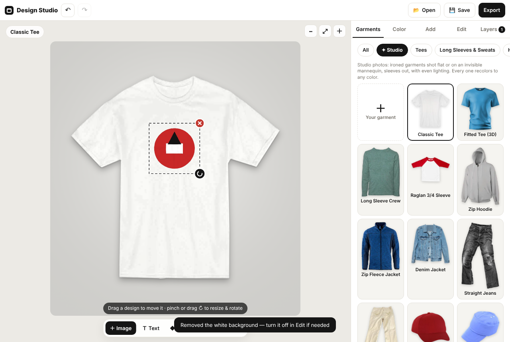
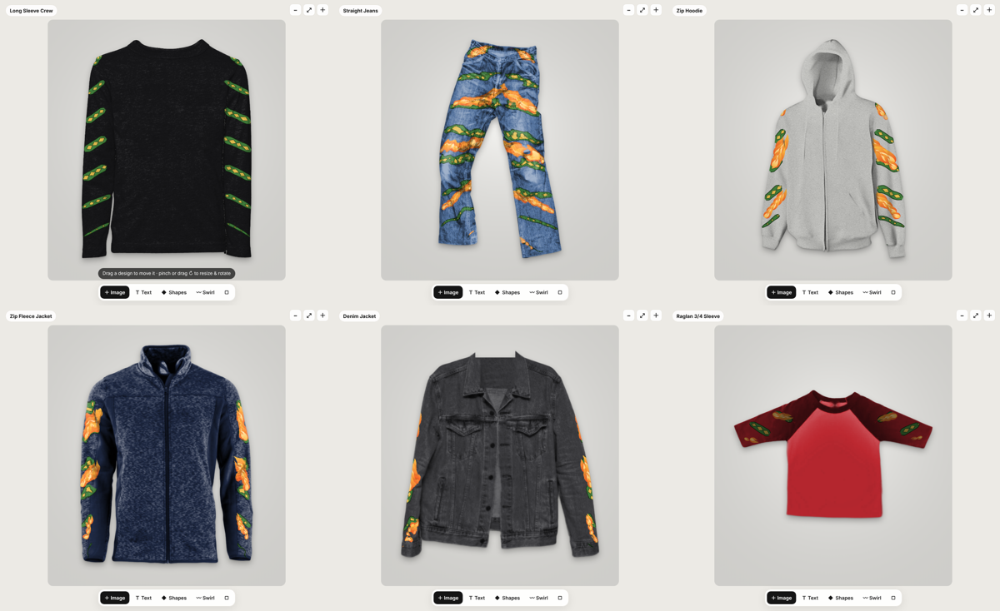

# Clothing Design Studio

A browser-based mockup tool for designing a clothing line. Drop your own artwork onto photos of real garments, recolor them, run designs around sleeves and pant legs, and export mockups and print files.



## Features

- **69 real garment photos**: tees, long sleeves and sweats, hoodies, shirts, jackets, pants, shorts, dresses and skirts, hats, and baby/kids items.
- **Studio set**: 11 ironed garments shot flat or on an invisible mannequin, with even lighting and no logos or brand labels.
- **Any color**: a palette of garment colors, heather options and a custom color picker. Every garment recolors while keeping its folds and shading.
- **Scan hand drawings**: take a photo of a drawing on paper with **📷 Scan**. The page finds the paper, straightens it, removes shadows and the paper itself, and cleans up the lines. Keep the ink colors or switch to one ink color, erase stray marks, then put it on a garment or download it as a transparent PNG or a vector SVG.
- **Your artwork**: add images, text and shapes, then move, resize and rotate them. Prints bend with the fabric folds. White backgrounds can be removed automatically.
- **Sleeve and leg designs**: snake, ribbon, vine, flames, stars, hearts, chain, dots, lightning, text or your own image along the arms or legs. They can wrap around the limb, front → back → front.
- **Your own garments**: upload a photo of any blank garment (for example your printer's product photos) with **＋ Your garment**.
- **Export**: a single mockup, colorway sheets, a collection lineup, and a print file at print resolution.
- **Projects**: undo/redo, autosave in the browser, and save/open project files.



## Run it

There is no build step and nothing to install.

- **On your computer:** double-click `index.html`.
- **Online:** turn on **GitHub Pages** in the repository settings (Settings → Pages → Deploy from a branch → `main` / root).
- **Local server (optional):** `python3 -m http.server 8000`, then open <http://localhost:8000>.

## Scanning tips

- Lay the paper flat and shoot from straight above, in even daylight, without your phone's shadow on the paper.
- A darker table behind the paper helps the page find its edges. If it can't, drag the four corners onto the paper's corners.
- Faint pencil missing? Raise **Pick up faint lines**. Dust or stray dots? Raise **Remove specks** or use the **Eraser**.
- Everything runs in your browser; photos are never uploaded anywhere.

## Project structure

```
index.html   the whole app (HTML, CSS, JavaScript, garment catalog)
g/           garment photos: <name>.webp (cutout), <name>_m.webp (shading/fold maps), <name>_t.webp (thumbnail),
             <name>.js (the same photo and maps, used when index.html is opened straight from disk)
docs/        screenshots for this README
```

## Photo credits

All garment photos are of real clothes. They were cut out, retouched (logos and brand labels removed) and made recolorable.

Studio set:

| Garment | Photo by | License | Link |
|---|---|---|---|
| Classic Tee | Pixabay | Pixabay Content License | [source](https://pixabay.com/photos/blank-tshirt-male-fashion-top-1886013/) |
| Fitted Tee (3D) | Pixabay | Pixabay Content License | [source](https://pixabay.com/photos/template-tee-shirt-mannequin-blue-2710535/) |
| Long Sleeve Crew | Pixabay | Pixabay Content License | [source](https://pixabay.com/photos/isolated-t-shirt-tshirt-t-shirt-1852114/) |
| Raglan 3/4 Sleeve | Pixabay | Pixabay Content License | [source](https://pixabay.com/photos/mockup-t-shirt-shirt-tshirt-wear-5206369/) |
| Zip Hoodie | Mike Licht, NotionsCapital.com | [CC BY 2.0](https://creativecommons.org/licenses/by/2.0/) | [source](https://www.flickr.com/photos/9106303@N05/7009817703) |
| Zip Fleece Jacket | Pixabay | Pixabay Content License | [source](https://pixabay.com/photos/jacket-crivit-sport-highlights-2899729/) |
| Denim Jacket | ajay_suresh | [CC BY 2.0](https://creativecommons.org/licenses/by/2.0/) | [source](https://commons.wikimedia.org/wiki/File:Denim_Jacket_(51079649933).jpg) |
| Straight Jeans | THOR | [CC BY 2.0](https://creativecommons.org/licenses/by/2.0/) | [source](https://commons.wikimedia.org/wiki/File:Jeans_BW_2_(3213391837).jpg) |
| Trousers (back view) | the Digital Public Library of America (via Wikimedia Commons) | Public domain | [source](https://commons.wikimedia.org/wiki/File:Woman%27s_Gold_Denim_Jacket_and_Trousers_Worn_by_Bonnie_Blake_-_DPLA_-_420656887cc1ede978649a9e0219a1b5_(page_8).jpg) |
| Snapback Cap | Pixabay | Pixabay Content License | [source](https://pixabay.com/photos/hat-head-red-helmet-cap-2525910/) |
| Dad Cap | Pixabay | Pixabay Content License | [source](https://pixabay.com/photos/blue-work-cap-man-job-876999/) |

All other garments: [Clothing Dataset](https://github.com/alexeygrigorev/clothing-dataset) by Alexey Grigorev and contributors, public domain (CC0).

The photos keep their own licenses listed above. No license has been chosen yet for the code.
